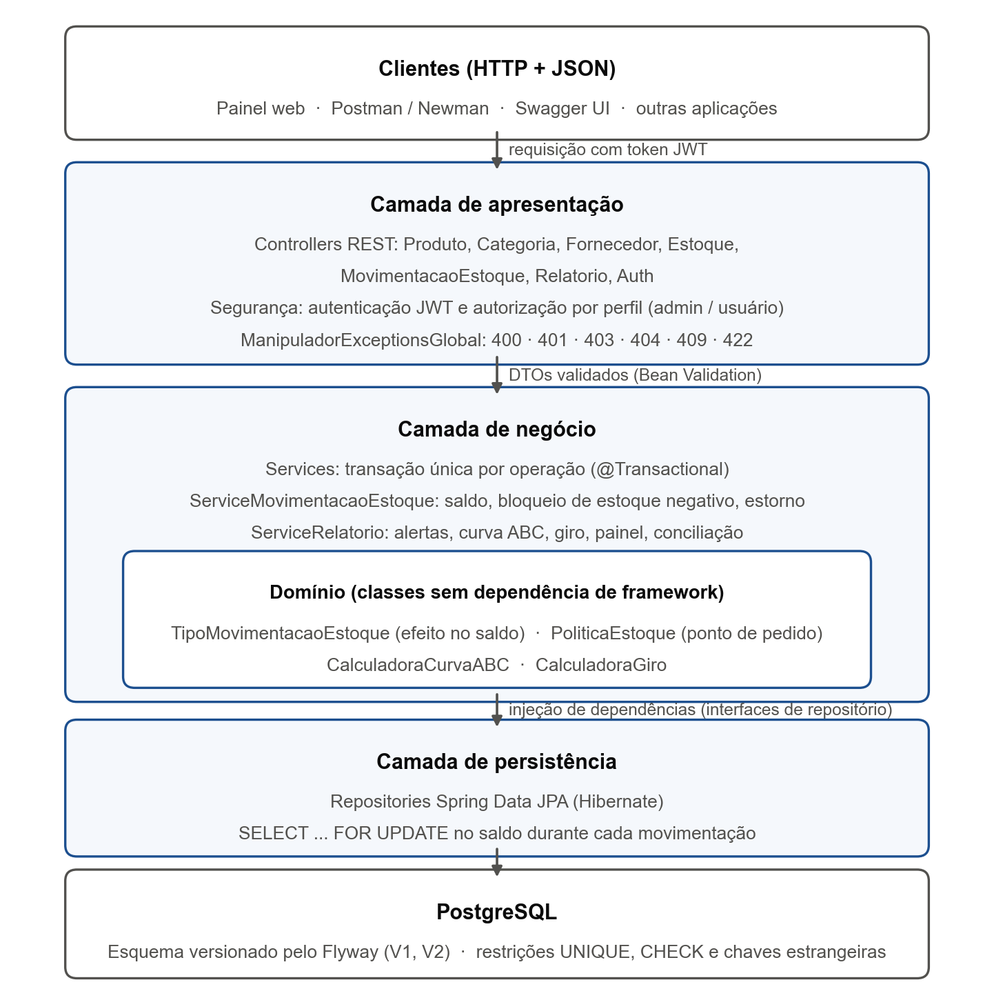
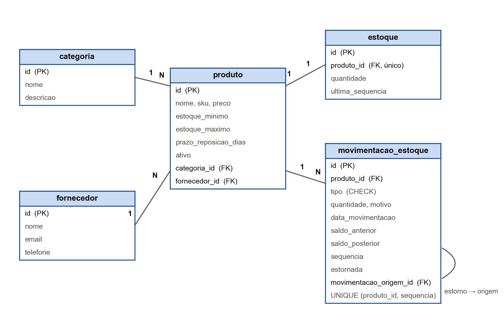

# Smart Stock

API RESTful de controle de estoque para micro e pequenas empresas, desenvolvida com **Java 21**, **Spring Boot 4** e **PostgreSQL** como prova de conceito do TCC *"Engenharia de Software no apoio a PMEs: construção de uma API escalável para controle de estoque"*.

Além dos cadastros, a API impede a geração de estoque negativo, mantém um histórico imutável de movimentações (kardex), sinaliza risco de ruptura e superestoque com sugestão de compra e calcula indicadores gerenciais: ponto de pedido, curva ABC e giro de estoque.



---

## Sumário

1. [Funcionalidades](#1-funcionalidades)
2. [Tecnologias](#2-tecnologias)
3. [Como executar](#3-como-executar)
4. [Endpoints](#4-endpoints)
5. [Regras de negócio](#5-regras-de-negócio)
6. [Modelo de dados](#6-modelo-de-dados)
7. [Testes e qualidade](#7-testes-e-qualidade)
8. [Resultados do experimento](#8-resultados-do-experimento)
9. [Estrutura do projeto](#9-estrutura-do-projeto)
10. [Modelagem inicial](#10-modelagem-inicial)

---

## 1. Funcionalidades

**Cadastros:** categorias, fornecedores e produtos (com estoque mínimo, estoque máximo e prazo de reposição do fornecedor).

**Movimentações de estoque**
- Entrada, saída, devolução e ajuste de inventário (o ajuste aceita valores negativos para perdas).
- Saída que deixaria o estoque negativo é recusada com **HTTP 422** e nada é gravado.
- Cada movimentação registra saldo anterior, saldo posterior e um número sequencial por produto (kardex).
- O histórico é imutável: não há edição nem exclusão. Erros de lançamento são corrigidos por **estorno**, que preserva o registro original.
- Atualização do saldo e gravação do histórico ocorrem na mesma transação, com bloqueio do saldo (`SELECT ... FOR UPDATE`) contra vendas simultâneas.

**Alertas e indicadores**
- Situação de cada produto: ruptura, crítico, repor (atingiu o ponto de pedido), normal ou superestoque.
- Ponto de pedido calculado: demanda média diária (últimos 30 dias) × prazo de reposição + estoque mínimo.
- Sugestão de compra em quantidade e valor.
- Curva ABC pelo valor vendido, giro de estoque, cobertura em dias, painel gerencial e série mensal de faturamento.
- Conciliação: confere se o saldo de cada produto é igual à soma do seu histórico.

**Segurança:** autenticação por token JWT e autorização por perfil. O **administrador** cadastra, altera, exclui e estorna; o **usuário** comum consulta e registra movimentações.

**Interfaces**
- **Painel web** em `http://localhost:8080`: indicadores, alertas, curva ABC, faturamento mensal e registro de movimentações.
- **Documentação interativa** (Swagger) em `http://localhost:8080/swagger-ui.html`.

---

## 2. Tecnologias

| Camada | Tecnologia |
|---|---|
| Linguagem e framework | Java 21, Spring Boot 4 (Web MVC, Data JPA, Security, Validation) |
| Banco de dados | PostgreSQL 18, migrações versionadas com Flyway |
| Segurança | Spring Security OAuth2 Resource Server (JWT RS256) |
| Mapeamento | MapStruct, Lombok |
| Documentação | springdoc-openapi (Swagger UI) |
| Testes | JUnit 5, Mockito, MockMvc, H2, Testcontainers, JaCoCo |
| Testes de API e carga | Postman/Newman, script Python de carga e concorrência |
| Implantação | Docker, Docker Compose |

---

## 3. Como executar

### Opção A: tudo em contêineres (recomendado para demonstração)

Requer apenas Docker.

```bash
docker compose --profile app up -d --build
```

Na primeira execução, o banco `smartstock_demo` é criado e populado com o cenário do experimento (cerca de 1 minuto). Depois disso:

- Painel: http://localhost:8080
- Swagger: http://localhost:8080/swagger-ui.html
- Login do administrador de desenvolvimento: `admin@admin.com` / `admin331400` (altere com `ADMIN_EMAIL` e `ADMIN_SENHA`)

### Opção B: banco no Docker, API pela IDE

```bash
docker compose up -d
./mvnw spring-boot:run
```

### Variáveis de ambiente

| Variável | Padrão | Uso |
|---|---|---|
| `DATASOURCE_URL` | `jdbc:postgresql://localhost:5432/apistock` | banco de dados |
| `DATASOURCE_USERNAME` / `DATASOURCE_PASSWORD` | `postgres` / `postgres` | credenciais do banco |
| `ADMIN_EMAIL` / `ADMIN_SENHA` | `admin@admin.com` / `admin331400` | administrador criado na primeira inicialização (obrigatórias no perfil `production`) |
| `SEED_ENABLED` | `true` | gera a massa de dados quando o banco não tem produtos |
| `SEED_DATA_FIM` | `2026-10-11` | último dia simulado; o padrão reproduz o experimento do TCC |
| `GOOGLE_CLIENT_ID` / `GOOGLE_CLIENT_SECRET` | não configurado | login social com Google (opcional) |
| `SHOW_SQL` | `false` | exibe o SQL gerado |

As chaves que assinam os tokens ficam em `src/main/resources/keys/` e não são versionadas. O build Docker gera um par próprio quando elas não existem. Para rodar pela IDE a partir de um clone novo, gere as chaves com:

```bash
openssl genpkey -algorithm RSA -pkeyopt rsa_keygen_bits:2048 -out src/main/resources/keys/app.key
```

```bash
openssl rsa -in src/main/resources/keys/app.key -pubout -out src/main/resources/keys/app.pub
```

### Banco de dados e migrações

O esquema é criado e evoluído pelo **Flyway** (`src/main/resources/db/migration`), e o Hibernate apenas valida se as entidades correspondem às tabelas (`ddl-auto: validate`). Bancos criados antes do Flyway são adotados automaticamente como versão 1. Alterações de estrutura devem entrar em um novo arquivo `V3__descricao.sql`, nunca editando um já aplicado.

---

## 4. Endpoints

Todas as rotas exigem `Authorization: Bearer <token>`, exceto o login, o cadastro de conta, o painel e a documentação. A referência completa, com exemplos, está no Swagger.

| Método | Rota | Perfil | Descrição |
|---|---|---|---|
| POST | `/auth` | público | Login; retorna o token JWT |
| POST | `/auth/signup` | público | Cria conta com perfil de usuário |
| GET / POST | `/categorias` | consulta: todos · cadastro: admin | Categorias |
| GET / POST / PUT / DELETE | `/fornecedores` | consulta: todos · alteração: admin | Fornecedores |
| GET / POST / PUT / DELETE | `/produtos` | consulta: todos · alteração: admin | Produtos |
| GET | `/produtos/pesquisar?nome=&sku=&categoria=` | todos | Pesquisa de produtos |
| GET | `/produtos/{id}/extrato` | todos | Kardex do produto |
| POST | `/estoques` | admin | Abre o estoque do produto com saldo inicial |
| POST | `/movimentacoesestoque` | todos | Registra entrada, saída, devolução ou ajuste |
| GET | `/movimentacoesestoque?produto_id=&tipo=&inicio=&fim=&pagina=&tamanho=` | todos | Lista paginada, mais recentes primeiro |
| POST | `/movimentacoesestoque/{id}/estorno` | admin | Estorna uma movimentação |
| GET | `/relatorios/painel` | todos | Valor em estoque, situação dos produtos, vendas de 30 dias |
| GET | `/relatorios/alertas` | todos | Produtos que exigem atenção, com sugestão de compra |
| GET | `/relatorios/curva-abc?inicio=&fim=` | todos | Curva ABC pelo valor vendido |
| GET | `/relatorios/giro?inicio=&fim=` | todos | Giro, estoque médio e cobertura |
| GET | `/relatorios/movimentacoes-mensais?inicio=&fim=` | todos | Série mensal de movimentações e faturamento |
| GET | `/relatorios/conciliacao` | todos | Auditoria: saldo = soma do histórico |

### Códigos de resposta

| Código | Quando |
|---|---|
| 200 / 201 / 204 | sucesso (consulta, criação, atualização sem corpo) |
| 400 | requisição malformada ou campo inválido (uma mensagem por campo) |
| 401 | sem token, token inválido ou credenciais incorretas |
| 403 | perfil sem permissão para a operação |
| 404 | recurso inexistente |
| 405 | tentativa de editar ou excluir uma movimentação |
| 409 | conflito com o estado dos dados (estoque duplicado, exclusão de registro com histórico, e-mail já cadastrado) |
| 422 | regra de negócio violada (saldo insuficiente, estorno repetido, produto inativo) |

---

## 5. Regras de negócio

| Regra | Comportamento |
|---|---|
| Estoque nunca negativo | saída ou ajuste que deixaria o saldo abaixo de zero é recusado (422) |
| Situação do produto | `RUPTURA` (saldo 0), `CRITICO` (< mínimo), `REPOR` (≤ ponto de pedido), `NORMAL`, `SUPERESTOQUE` (> máximo) |
| Ponto de pedido | `ceil(demanda média diária × prazo de reposição) + estoque mínimo` |
| Sugestão de compra | quantidade para voltar ao estoque máximo, quando o produto exige reposição |
| Estorno | cria movimentação com efeito inverso; a original é marcada como estornada; não se estorna um estorno nem a mesma movimentação duas vezes |
| Saldo inicial | abrir o estoque com quantidade gera uma `ENTRADA`, para que todo saldo tenha origem no histórico |
| Concorrência | o saldo do produto é bloqueado durante a movimentação; `UNIQUE (produto_id, sequencia)` impede duas movimentações na mesma posição |

Cada tipo de movimentação declara o próprio efeito sobre o saldo (`TipoMovimentacaoEstoque.efeitoNoSaldo`). Por isso, incluir um novo tipo não exige alterar o serviço (princípio Aberto/Fechado).

---

## 6. Modelo de dados



---

## 7. Testes e qualidade

```bash
./mvnw test
```

A suíte tem **92 testes** (JUnit 5): unidade, integração com H2 e integração com **PostgreSQL real via Testcontainers**. Os testes no PostgreSQL são ignorados automaticamente quando o Docker não está disponível. O relatório de cobertura (JaCoCo) fica em `target/site/jacoco/index.html`.

| Suíte | O que verifica |
|---|---|
| `TipoMovimentacaoEstoqueTest`, `PoliticaEstoqueTest`, `CalculadoraCurvaABCTest`, `CalculadoraGiroTest` | regras e cálculos de domínio, sem banco |
| `ServiceMovimentacaoEstoqueTest` | regras do serviço com repositórios simulados (Mockito) |
| `MovimentacaoEstoqueIntegracaoTest` | fluxos HTTP de movimentação, estorno e paginação |
| `ConfiabilidadeApiIntegracaoTest` | códigos de erro da API |
| `AutenticacaoIntegracaoTest`, `AutorizacaoIntegracaoTest` | login com JWT real, cadastro de conta, perfis e rotas públicas |
| `RelatorioIntegracaoTest` | alertas, curva ABC, giro, painel e conciliação |
| `TransacaoEConcorrenciaIntegracaoTest` | atomicidade e saídas simultâneas |
| `PostgresIntegracaoTest` | migrações Flyway, concorrência e restrições no PostgreSQL |
| `GeradorDeDadosIntegracaoTest` | consistência do cenário gerado pelo seed |

Cobertura medida: **85,4% das linhas e 83,9% dos ramos**. A camada de domínio tem 98,6% das linhas cobertas e os serviços, 85,6%.

Outras verificações em `docs/` e `scripts/`:

```bash
npx newman run docs/postman/SmartStock.postman_collection.json --env-var baseUrl=http://localhost:8080
```

```bash
py scripts/teste_carga.py --url http://127.0.0.1:8080 --requisicoes 1000
```

```bash
docker exec -i postgres_api_stock psql -U postgres -d smartstock_demo < docs/consultas-auditoria.sql
```

---

## 8. Resultados do experimento

O seed simula um minimercado com 59 produtos durante 26 semanas (15.635 movimentações). A simulação é determinística: com o período padrão, toda execução reproduz exatamente os mesmos números. Os resultados medidos (testes, carga, auditoria e indicadores) estão em [`docs/RESULTADOS-TCC.md`](docs/RESULTADOS-TCC.md), os dados brutos em `docs/resultados/` e as figuras em `docs/figuras/` (regeneradas com `py scripts/gerar_figuras.py`).

---

## 9. Estrutura do projeto

```
src/main/java/.../api
├── config/          segurança, OpenAPI, administrador inicial e gerador de dados (seed)
├── controllers/     camada de apresentação (REST)
├── services/        regras de negócio e transações
├── domain/
│   ├── entities/    entidades JPA
│   ├── enums/       tipos de movimentação e situação do estoque
│   ├── indicadores/ cálculos puros: ponto de pedido, curva ABC, giro
│   └── dtos/        contratos de entrada e saída da API
├── respository/     acesso a dados (Spring Data JPA)
├── mapper/          conversão entidade ↔ DTO (MapStruct)
└── exceptions/      tratamento global de erros
src/main/resources/
├── db/migration/    migrações Flyway
└── static/          painel web
```

---

## 10. Modelagem inicial

Diagramas UML produzidos no planejamento do projeto. Eles registram o escopo idealizado, que inclui itens não implementados nesta prova de conceito (importação CSV, alertas por e-mail, inventário por lote). O sistema implementado está descrito nas seções anteriores.


Versões em SVG: [casos de uso](docs/diagramas/casos-de-uso.svg) · [classes](docs/diagramas/classes.svg) · [entidade-relacionamento](docs/diagramas/entidade-relacionamento.svg) · [arquitetura](docs/diagramas/arquitetura.svg) · [implantação](docs/diagramas/implantacao.svg)

---

Projeto desenvolvido para fins acadêmicos.
